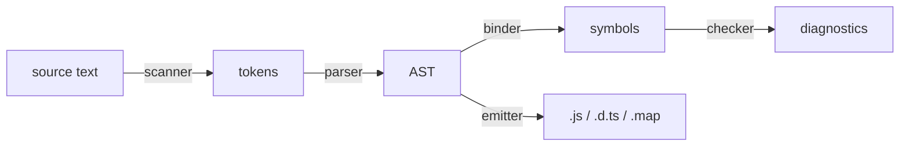

# 1 - From JavaScript to TypeScript

---
src: ../../typescript-common/slides/01_getting_started/learning-objectives.md
---

---

# What TypeScript is

- A language by **Microsoft**, designed by Anders Hejlsberg — the author of
  **Turbo Pascal**, **Delphi** and **C#** — open source since 2012
- A **superset** of JavaScript: every JavaScript program is a TypeScript program
- It adds one thing: **static types**, checked **before** the code runs

```ts
function total(prices: number[]): number {
  return prices.reduce((sum, price) => sum + price, 0);
}

total([10, 20]);
total(['10', '20']);
//     ~~~~ Type 'string' is not assignable to type 'number'.
```

- The types are **erased**: what runs is plain JavaScript. A type never exists
  at run time — keep that in mind for the whole training

---
src: ../../typescript-common/slides/01_getting_started/why-bother.md
---

---

# Setting up a project

```bash
mkdir todo && cd todo
npm init --yes
npm install --save-dev typescript @types/node
npx tsc --init
```

- `typescript` ships the compiler, **`tsc`**
- `@types/node` describes the Node.js APIs (`process`, `node:fs`…) to the checker
- `tsc --init` writes a commented **`tsconfig.json`**

<br />

> **TypeScript 7** is the **native** port of the compiler (written in Go):
> same `tsc` command, same options, **8 to 12× faster** on a full build
> (VS Code: 126 s → 11 s). On a whole CI, expect less — Prisma measured **~3×**
> on its monorepo. Since 7.0 it ships as the `typescript` package itself.

---

# `tsconfig.json`

```json
{
  "compilerOptions": {
    "target": "esnext",            // the JavaScript version emitted
    "module": "nodenext",          // how imports are resolved — here, like Node.js
    "lib": ["esnext"],             // the built-in APIs the code may use
    "types": ["node"],             // the @types packages loaded globally
    "strict": true,                // the checks you want — always on
    "noEmit": true,                // only check: something else runs the code
    "skipLibCheck": true           // do not check the .d.ts of node_modules
  },
  "include": ["src/**/*.ts"]
}
```

- `tsc` with no argument reads it: `npx tsc` checks — and emits, unless `noEmit`
- `npx tsc --showConfig` prints the **effective** config, defaults and `extends` resolved
- `npx tsc --listFiles` lists every file the compiler reads — your code, and all the `lib.*.d.ts`

---

# The defaults changed — TypeScript 6 and 7

What you get **without writing it**:

| Option | Before (5.x) | Now (6.0, 7.0) |
|---|---|---|
| `strict` | `false` | **`true`** |
| `module` | depends on `target` | `esnext` |
| `target` | `es5` | the latest: `es2025` |
| `types` | every `node_modules/@types` | **`[]`** — list them: `["node"]` |
| `rootDir` | inferred from the sources | the folder of `tsconfig.json` |
| `noUncheckedSideEffectImports` | `false` | `true` |

```txt
error TS2304: Cannot find name 'process'.     ← the classic one after upgrading: add "types": ["node"]
```

- Gone in 7.0: `target: "es5"`, `moduleResolution: "node10"`, `baseUrl`, `outFile`,
  `module: "amd" | "umd" | "system"` — see chapter 9
- `tsc file.ts` next to a `tsconfig.json` is now an **error**: `--ignoreConfig` to bypass it
- `tsc --init` now writes a short, opinionated file: `module: nodenext`, `target: esnext`,
  `types: []`, `strict`, plus `noUncheckedIndexedAccess`, `exactOptionalPropertyTypes`,
  `verbatimModuleSyntax`, `isolatedModules` — read it before keeping it

---

# `strict`: the setting that matters

`strict: true` turns on a **family** of checks — among them:

| Option | What it refuses |
|---|---|
| `noImplicitAny` | A parameter whose type cannot be inferred: no silent `any` |
| `strictNullChecks` | Using a value that may be `null` or `undefined` |
| `strictFunctionTypes` | Passing a callback that accepts less than promised |
| `strictPropertyInitialization` | A class field never assigned |
| `useUnknownInCatchVariables` | `catch (e)`: `e` is `unknown`, not `any` |

```ts
function greet(name) {}                 // ✘ Parameter 'name' implicitly has an 'any' type.

const last = ['a', 'b'].at(-1);         // string | undefined
last.toUpperCase();                     // ✘ 'last' is possibly 'undefined'.
```

> Without `strict`, TypeScript is a linter with good completion. It is **on by
> default** since TypeScript 6: an old project that turns it off says so with
> `"strict": false` — migrate it flag by flag.

---
src: ../../typescript-common/slides/01_getting_started/running-typescript.md
---

---

# Type stripping, and its limit

Node.js replaces each type with **spaces** — line and column numbers stay right:

```ts
function add(a: number, b: number): number { return a + b; }
// becomes
function add(a        , b        )         { return a + b; }
```

- Only works for syntax that is **pure annotation**. `enum`, `namespace` and
  constructor **parameter properties** generate code: Node.js refuses them
- `"erasableSyntaxOnly": true` makes `tsc` refuse them too — before Node.js does
- Imports name the **real file**: `import { add } from './math.ts'`
  (`"allowImportingTsExtensions": true` lets `tsc` accept it)
- `"verbatimModuleSyntax": true`: a type-only import must say so —
  `import type { Todo } from './todo.ts'` — so it can be erased safely
- `node --experimental-transform-types` also **transforms** `enum` and `namespace` —
  still experimental, and it breaks the "spaces only" promise: source maps are
  needed again. Prefer `erasableSyntaxOnly`

---

# What happens in `tsc`



- **Scanner**: text into tokens — `function`, `add`, `(`…
- **Parser**: tokens into an **Abstract Syntax Tree**
- **Binder**: connects each name to its declaration, scope by scope
- **Checker**: the type system — by far the most expensive stage
- **Emitter**: writes JavaScript, declaration files (`.d.ts`) and source maps

> The emitter does **not** wait for the checker: by default, `tsc` writes the
> `.js` even when there are type errors. `noEmitOnError` changes that.

---
src: ../../typescript-common/slides/01_getting_started/the-editor.md
---

---
src: ../../typescript-common/slides/01_getting_started/quiz.md
---

---
layout: cover
---

# Hands-on

## Workshop 1 - Getting started
