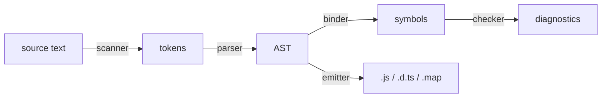

# 1 - From JavaScript to TypeScript

---

# Learning objectives

At the end of this chapter, you will be able to:

- **Explain** what TypeScript adds to JavaScript — and what it removes before running
- **Set up** a project: `typescript`, `tsc`, `tsconfig.json`
- **Run** a `.ts` file, and tell **type stripping** from **type checking**
- **Turn on** `strict`, and read the errors it reports
- **Describe** the stages of a compilation

---

# What TypeScript is

- A language by **Microsoft**, designed by Anders Hejlsberg — the author of
  **Turbo Pascal**, **Delphi** and **C#** — open source since 2012
- A **superset** of JavaScript: every JavaScript program is a TypeScript program
- It adds one thing: **static types**, checked **before** the code runs

```ts
function total(prices: number[]): number {
  return prices.reduce((sum, price) => sum + price, 0);
}

total([10, 20]);
total(['10', '20']);
//     ~~~~ Type 'string' is not assignable to type 'number'.
```

- The types are **erased**: what runs is plain JavaScript. A type never exists
  at run time — keep that in mind for the whole training

---

# Why bother

- **Errors move left**: a typo, a missing `null` check, a wrong argument is
  found in the editor, not in production
- **The editor knows your code**: completion, go to definition, safe renames
- **Types are documentation** that cannot drift from the code
- **Refactoring at scale**: change a type, follow the errors

<br />

> TypeScript is not a test framework: it says the code is **consistent**, not
> that it is **right**. `total([10, 20])` returning `40` type checks perfectly.

---

# Setting up a project

```bash
mkdir todo && cd todo
npm init --yes
npm install --save-dev typescript @types/node
npx tsc --init
```

- `typescript` ships the compiler, **`tsc`**
- `@types/node` describes the Node.js APIs (`process`, `node:fs`…) to the checker
- `tsc --init` writes a commented **`tsconfig.json`**

<br />

> **TypeScript 7** is the **native** port of the compiler (written in Go):
> same `tsc` command, same options, about **10× faster**.

---

# `tsconfig.json`

```json
{
  "compilerOptions": {
    "target": "esnext",            // the JavaScript version emitted
    "module": "nodenext",          // how imports are resolved — here, like Node.js
    "lib": ["esnext"],             // the built-in APIs the code may use
    "types": ["node"],             // the @types packages loaded globally
    "strict": true,                // the checks you want — always on
    "noEmit": true,                // only check: something else runs the code
    "skipLibCheck": true           // do not check the .d.ts of node_modules
  },
  "include": ["src/**/*.ts"]
}
```

- `tsc` with no argument reads it: `npx tsc` checks — and emits, unless `noEmit`
- `npx tsc --showConfig` prints the **effective** config, defaults and `extends` resolved
- `npx tsc --listFiles` lists every file the compiler reads — your code, and all the `lib.*.d.ts`

---

# `strict`: the setting that matters

`strict: true` turns on a **family** of checks — among them:

| Option | What it refuses |
|---|---|
| `noImplicitAny` | A parameter whose type cannot be inferred: no silent `any` |
| `strictNullChecks` | Using a value that may be `null` or `undefined` |
| `strictFunctionTypes` | Passing a callback that accepts less than promised |
| `strictPropertyInitialization` | A class field never assigned |
| `useUnknownInCatchVariables` | `catch (e)`: `e` is `unknown`, not `any` |

```ts
function greet(name) {}                 // ✘ Parameter 'name' implicitly has an 'any' type.

const last = ['a', 'b'].at(-1);         // string | undefined
last.toUpperCase();                     // ✘ 'last' is possibly 'undefined'.
```

> Without `strict`, TypeScript is a linter with good completion. **Start every
> project strict**; migrate an old one flag by flag.

---

# Running TypeScript

| | Checks the types? | How |
|---|---|---|
| `tsc` | ✔ | Checks, then writes `.js` files |
| `node file.ts` | ✘ | Node.js 22.18+ **strips** the types and runs what is left |
| `tsx file.ts` | ✘ | esbuild strips the types — and supports every syntax |
| Vite, Vitest, esbuild… | ✘ | Same: they **transpile**, they never check |

- Every runner **erases** the types — only `tsc` reads them
- So a project runs with one tool, and **checks** with `tsc --noEmit` — in the
  editor, in a pre-commit hook, in the CI

---

# Type stripping, and its limit

Node.js replaces each type with **spaces** — line and column numbers stay right:

```ts
function add(a: number, b: number): number { return a + b; }
// becomes
function add(a        , b        )         { return a + b; }
```

- Only works for syntax that is **pure annotation**. `enum`, `namespace` and
  constructor **parameter properties** generate code: Node.js refuses them
- `"erasableSyntaxOnly": true` makes `tsc` refuse them too — before Node.js does
- Imports name the **real file**: `import { add } from './math.ts'`
  (`"allowImportingTsExtensions": true` lets `tsc` accept it)
- `"verbatimModuleSyntax": true`: a type-only import must say so —
  `import type { Todo } from './todo.ts'` — so it can be erased safely

---

# What happens in `tsc`



- **Scanner**: text into tokens — `function`, `add`, `(`…
- **Parser**: tokens into an **Abstract Syntax Tree**
- **Binder**: connects each name to its declaration, scope by scope
- **Checker**: the type system — by far the most expensive stage
- **Emitter**: writes JavaScript, declaration files (`.d.ts`) and source maps

> The emitter does **not** wait for the checker: by default, `tsc` writes the
> `.js` even when there are type errors. `noEmitOnError` changes that.

---

# The editor

- The editor runs the **same** checker as `tsc`, on every keystroke — via the
  TypeScript language server
- **VS Code**: built in. **WebStorm** / **IntelliJ IDEA**: built in
- Hover to see an inferred type; `Ctrl` / `Cmd` + click to jump to a declaration
- The **Pretty TypeScript Errors** extension (`yoavbls.pretty-ts-errors`) makes
  long errors readable
- The [TypeScript Playground](https://www.typescriptlang.org/play) runs the
  compiler in the browser: perfect to test a type, or to share one

---

# Quiz — Question 1 / 3

**`node src/cli.ts` prints the right output, but `npx tsc --noEmit` reports
three errors. How is that possible?**

- **A.** Node.js uses an older version of TypeScript
- **B.** Node.js strips the types without checking them
- **C.** `tsc --noEmit` only checks, so its errors do not count
- **D.** Node.js fixes the errors before running the file

<v-click>

> ✅ **B** — Running and checking are two different jobs. Node.js, tsx, Vite and
> Vitest all **erase** the types; only `tsc` (and the editor) **reads** them.
> A green run says nothing about the types.

</v-click>

---

# Quiz — Question 2 / 3

**With `strict` off, what is the type of `title` in
`function createTodo(title) {}`?**

- **A.** `string`
- **B.** `unknown`
- **C.** `any`
- **D.** It is a compile error

<v-click>

> ✅ **C** — An **implicit `any`**: anything is accepted, nothing is checked.
> With `strict` (precisely `noImplicitAny`), it becomes the error
> *Parameter 'title' implicitly has an 'any' type* — which is the point.

</v-click>

---

# Quiz — Question 3 / 3

**Why does `node file.ts` refuse an `enum`, when it accepts an interface?**

- **A.** Node.js does not support TypeScript 5 syntax
- **B.** An `enum` generates JavaScript code; an interface is erased entirely
- **C.** An `enum` needs `"strict": true`
- **D.** Interfaces are part of JavaScript

<v-click>

> ✅ **B** — Type stripping can only **remove** text. An `enum` becomes an
> object at run time: it is not erasable syntax. `"erasableSyntaxOnly": true`
> makes `tsc` report it before Node.js does.

</v-click>

---
layout: cover
---

# Hands-on

## Workshop 1 - Getting started
